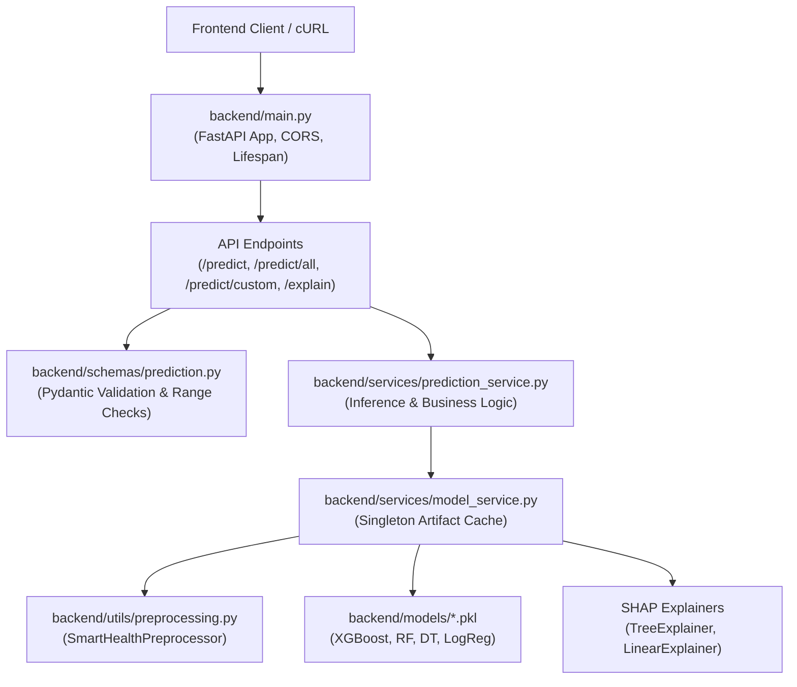
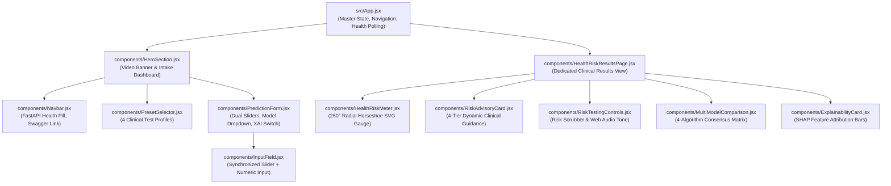
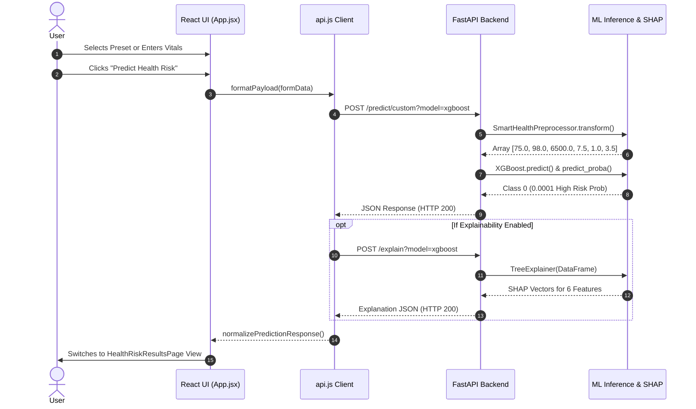
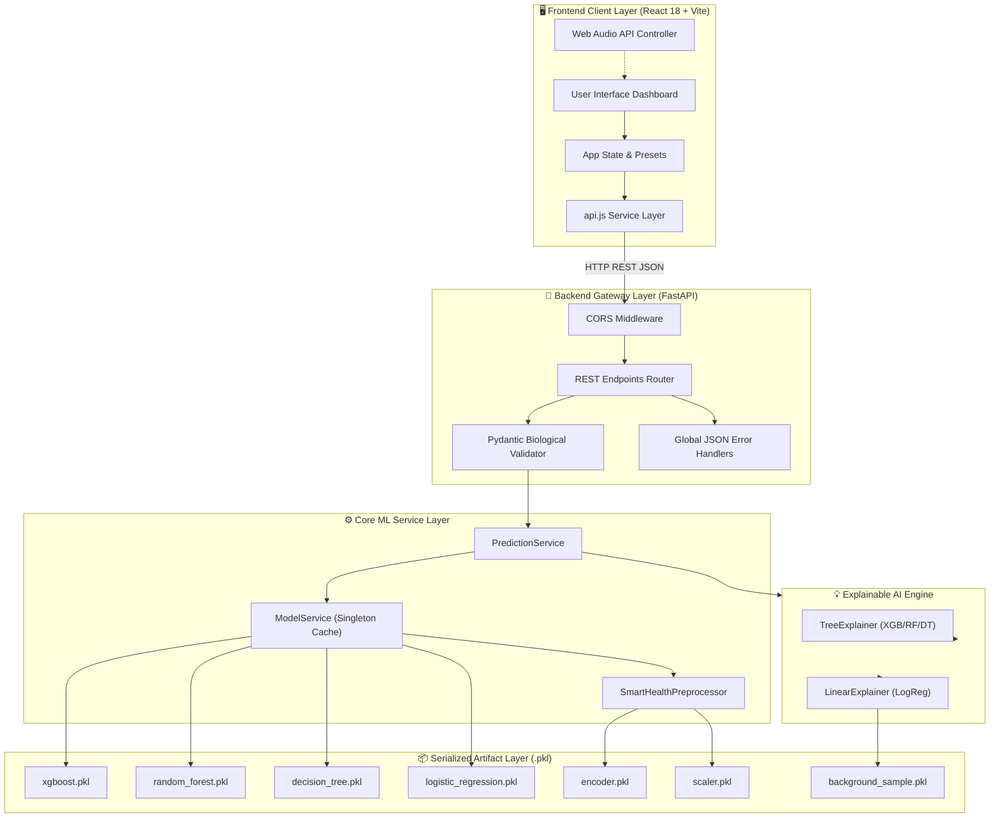

# 🌿 SmartHealth Stress Prediction

> **An end-to-end machine learning application for predicting physiological stress levels and health risk from wearable biometric data, featuring multiple ML classifiers, Explainable AI (SHAP), a high-performance FastAPI REST backend, and an interactive React frontend dashboard.**

---

## 📑 Table of Contents

1. [Project Overview](#-project-overview)
2. [Key Features](#-key-features)
3. [Complete Development Lifecycle](#-complete-development-lifecycle)
4. [Dataset & Biometric Features](#-dataset--biometric-features)
5. [Exploratory Data Analysis (EDA)](#-exploratory-data-analysis-eda)
6. [Data Preprocessing Pipeline](#-data-preprocessing-pipeline)
7. [Machine Learning Models](#-machine-learning-models)
8. [Model Comparison & Benchmark Results](#-model-comparison--benchmark-results)
9. [Model Selection & Production Strategy](#-model-selection--production-strategy)
10. [Model & Preprocessor Serialization](#-model--preprocessor-serialization)
11. [Explainable AI (SHAP)](#-explainable-ai-shap)
12. [Backend Architecture](#-backend-architecture)
13. [REST API Documentation](#-rest-api-documentation)
14. [Frontend Architecture & UI Components](#-frontend-architecture--ui-components)
15. [Frontend-Backend Communication](#-frontend-backend-communication)
16. [Complete System Architecture](#-complete-system-architecture)
17. [Project Folder Structure](#-project-folder-structure)
18. [Installation & Requirements](#-installation--requirements)
19. [How to Run the Project](#-how-to-run-the-project)
20. [Environment Variables](#-environment-variables)
21. [Automated Testing](#-automated-testing)
22. [Security & Production Considerations](#-security--production-considerations)
23. [Limitations](#-limitations)
24. [Future Improvements](#-future-improvements)
25. [Tech Stack](#-tech-stack)
26. [Development Timeline & Evolution](#-development-timeline--evolution)
27. [Responsible Use & Disclaimer](#-responsible-use--disclaimer)
28. [License](#-license)
29. [Author & Credits](#-author--credits)

---

## 🔬 Project Overview

### What Problem Does This Project Solve?
Psychological and physical stress triggers immediate physiological responses across the human autonomic nervous system, influencing cardiac rhythms, blood oxygen saturation, sleep continuity, and motor activity. Traditional clinical stress detection depends on retrospective surveys, subjective self-reporting, or cumbersome laboratory equipment. 

**SmartHealth Stress Prediction** bridges this gap by translating continuous biometric telemetry captured by commercial smartwatches and wearable sensors into real-time, deterministic health risk and stress classification.

### Why Wearable Biometrics for Stress Detection?
Smartwatches continuously track critical biomarkers:
* **Heart Rate (BPM)** — Reflects sympathetic nervous system arousal and parasympathetic withdrawal.
* **Blood Oxygen Saturation ($SpO_2$)** — Indicates respiratory efficiency and systemic oxygenation under acute strain.
* **Daily Step Count** — Measures physical mobility, sedentary behavior, and daily exertion.
* **Sleep Duration** — Captures restorative autonomic recovery cycles; sleep deficits strongly amplify stress vulnerability.
* **Physical Activity Level** — Contextualizes whether elevated pulse rates stem from physical exercise or psychological tension.
* **Sensor Stress Score** — Integrates galvanic skin response (GSR) and perceived stress indicators.

### What the Machine Learning System Predicts
The system performs binary classification on physiological profiles:
* **`0` — Low Stress / Low Health Risk:** Autonomic stability, healthy cardiovascular baseline, and restorative balance.
* **`1` — High Stress / Elevated Health Risk:** Sympathetic hyperarousal, reduced recovery capacity, and heightened health strain.

In addition to discrete labels, the system calculates exact class probabilities, continuous **Health Risk Scores (0–100%)**, assigns **4-Tier Clinical Categories** (*Low, Moderate, Elevated, Critical*), and generates customized lifestyle recommendations.

### Why Multiple Models Were Developed
Rather than relying on a single classifier, this project developed, tuned, and evaluated four distinct algorithms—**Logistic Regression**, **Decision Tree**, **Random Forest**, and **XGBoost Classifier**. This enables benchmarking linear statistical baselines against non-linear bagging and gradient boosting ensembles, providing a **Multi-Model Consensus Matrix** during inference.

### How Explainability Is Provided
Machine learning in healthcare requires transparency. SmartHealth integrates **SHAP (SHapley Additive exPlanations)** to compute local feature attribution vectors for every prediction. The user and practitioner can see exactly how each vital sign mathematically contributed to increasing (+ risk driver) or decreasing (- protective factor) the predicted stress score.

### How the Final Application Works
1. The user inputs their vital signs manually or selects one of four realistic clinical presets (*Optimal Health*, *Acute Strain*, *Athletic Recovery*, *Workday Fatigue*) on the React dashboard.
2. The React frontend sends validated JSON payloads to the FastAPI REST backend via an asynchronous API client.
3. The backend preprocessor cleans, encodes, and structures the features into the exact matrix expected by the ML models.
4. The pre-loaded ML model executes inference in under 2 milliseconds.
5. The dedicated `/explain` endpoint runs SHAP attribution to extract localized feature importances.
6. The frontend renders the complete diagnosis on an interactive results dashboard featuring a 260° radial horseshoe gauge, keyframe heartbeat animations, multi-model consensus bars, and empathetic advisories.

---

## ✨ Key Features

* 🚀 **Multi-Algorithm Machine Learning Suite:** Simultaneous support for XGBoost, Random Forest, Decision Tree, and Logistic Regression.
* 🎯 **Precision Stress & Health Risk Prediction:** Classifies physiological states with calibrated probabilities and quantified percentage risk scores.
* 📊 **4-Tier Risk Categorization:** Automatically maps predictions into *Low (<25%)*, *Moderate (25–49%)*, *Elevated (50–74%)*, and *Critical (75–100%)* tiers.
* 🎛️ **Simultaneous Multi-Model Benchmarking (`/predict/all`):** Executes all four algorithms concurrently and computes an ensemble consensus percentage.
* 🔍 **Detailed Custom Auditing (`/predict/custom`):** Returns raw inputs, encoded internal representations, confidence percentages, and structured medical advice.
* 💡 **Explainable AI with SHAP (`/explain`):** Local feature attribution ranking positive and negative biometric contributors to eliminate black-box uncertainty.
* 🧭 **260° Radial Horseshoe SVG Gauge:** Custom 51-tick vector gauge with smooth cubic easing, color gradients, and interactive click-and-drag simulation.
* 💓 **Biometric Heartbeat Visualizer & Audio Synth:** Dynamic keyframe pulse animations and optional Web Audio API cardiac tones matched to real-time BPM.
* 📋 **1-Click Clinical Test Presets:** Instant testing of realistic scenarios (*Optimal Rested*, *Acute Strain*, *Athletic Recovery*, *Workday Fatigue*).
* 🛡️ **Pydantic Data Validation:** Strict biological range constraints with support for both original dataset column titles and `snake_case` aliases.
* 🌐 **FastAPI REST Backend:** Asynchronous endpoints, automated Swagger UI (`/docs`) and ReDoc (`/redoc`) documentation, and singleton model management.
* 📦 **Zero-Retraining Runtime Architecture:** Models and encoders are pre-fitted and loaded into memory on server boot for sub-millisecond latency.
* 🖥️ **Single-Port Production Serving:** FastAPI automatically mounts and serves the compiled React Single Page Application (SPA) directly from `frontend/dist`.

---

## 🔄 Complete Development Lifecycle

The project followed a disciplined, end-to-end data science and software engineering methodology:

```mermaid
flowchart TD
    A["1. Dataset Ingestion<br/>(9,040 rows, 7 columns)"] --> B["2. Data Understanding &<br/>Target Profiling"]
    B --> C["3. Exploratory Data Analysis<br/>(Univariate & Bivariate)"]
    C --> D["4. Data Cleaning &<br/>Typo Normalization"]
    D --> E["5. Feature Selection &<br/>Target Separation"]
    E --> F["6. Categorical Encoding &<br/>Preprocessing Pipeline"]
    F --> G["7. Stratified Train/Test Split<br/>(80% Train / 20% Test)"]
    G --> H["8. Baseline Model Training<br/>(4 Algorithms)"]
    H --> I["9. Stratified 5-Fold<br/>Cross-Validation"]
    I --> J["10. Hyperparameter Tuning<br/>(RandomizedSearchCV)"]
    J --> K["11. Model Evaluation &<br/>Benchmarking"]
    K --> L["12. Production Model Selection<br/>(XGBoost Champion)"]
    L --> M["13. Explainability Integration<br/>(SHAP Tree & Linear)"]
    M --> N["14. Artifact Serialization<br/>(Joblib .pkl Files)"]
    N --> O["15. FastAPI Backend Engine<br/>(Singleton Architecture)"]
    O --> P["16. Automated Testing<br/>(Pytest Suite)"]
    P --> Q["17. React 18 Frontend<br/>(Vite + Tailwind CSS)"]
    Q --> R["18. Full-Stack Integration<br/>(Decoupled REST API)"]
    R --> S["19. Production Build &<br/>Static SPA Serving"]
```



---

## 📁 Dataset & Biometric Features

### Dataset Metadata
* **Dataset File:** `SmartWatch_health_with_target (1).csv`
* **Dataset Source:** Not specified in the repository.
* **Total Records (Rows):** `9,040`
* **Total Attributes (Columns):** `7` (6 predictive features + 1 binary target)
* **Missing Values:** `0` (No null or missing values across any column)
* **Duplicate Rows:** `0` (No duplicate observations)

### Target Variable Distribution
* **Target Column:** `Health Risk` (Integer: `0` or `1`)
  * **Class `0` (Low Health Risk / Low Stress):** `7,082` samples (**78.34%**)
  * **Class `1` (Elevated Health Risk / High Stress):** `1,958` samples (**21.66%**)

### Feature Dictionary & Summary Statistics

| Feature Name | Column Type | Accepted Range | Mean | Std Dev | Description |
| :--- | :--- | :--- | :--- | :--- | :--- |
| **`Heart Rate (BPM)`** | Numeric (`int64` / `float`) | `30.0` – `250.0` | `75.50` | `19.10` | Pulse frequency measured in beats per minute. |
| **`Blood Oxygen Level (%)`** | Numeric (`int64` / `float`) | `50.0` – `100.0` | `97.40` | `1.82` | Arterial blood oxygen saturation percentage ($SpO_2$). |
| **`Step Count`** | Numeric (`int64` / `float`) | `0.0` – `150,000.0` | `6,966.50` | `6,849.28` | Total accumulated daily physical movement steps. |
| **`Sleep Duration (hours)`** | Numeric (`int64` / `float`) | `0.0` – `24.0` | `6.01` | `1.53` | Total hours of restorative sleep in the last 24h cycle. |
| **`Activity Level`** | Categorical (`str` / `float`) | `sedentary`, `active`, `highly active` | — | — | Routine lifestyle exertion tier (encoded as `0`, `1`, `2`). |
| **`Stress Level`** | Numeric (`int64` / `float`) | `0.0` – `10.0` | `5.44` | `2.84` | Galvanic skin response / perceived sensor stress index. |

---

## 📈 Exploratory Data Analysis (EDA)

In `Demo.ipynb`, exploratory data analysis was conducted to uncover physiological relationships and data quality:

### 1. Univariate Analysis
* **Histograms with Kernel Density Estimation (KDE):**
  * `Heart Rate (BPM)` exhibits a central peak around 70–80 BPM, with a long right tail extending up to 292 BPM reflecting acute exertion or tachycardia.
  * `Blood Oxygen Level (%)` shows a tight, left-skewed distribution centered between 96% and 99%, with minimum values around 90%.
  * `Step Count` displays an exponential decay shape with heavy concentrations under 8,000 steps and maximum observations reaching 62,486 steps.
  * `Sleep Duration (hours)` follows a symmetric distribution centered at 6 hours (range 0 to 11 hours).
  * `Stress Level` spans evenly from 1 to 10 with a mean of 5.44.
* **Boxplots:** Verified the absence of impossible physiological zeros for heart rate and confirmed outlier bounds across vitals.

### 2. Categorical Analysis
The raw `Activity Level` column revealed data entry inconsistencies and typographical variations:
* `Seddentary`: 1,544 rows
* `Sedentary`: 1,541 rows
* `Highly Active`: 1,523 rows
* `Actve`: 1,510 rows
* `Active`: 1,493 rows
* `Highly_Active`: 1,429 rows

### 3. Bivariate Relationships
* **Stress Level vs. Sleep Duration:** Negative correlation; individuals reporting stress scores $\ge 7$ consistently recorded sleep durations under 5 hours.
* **Stress Level vs. Heart Rate:** Strong positive association; higher subjective/sensor stress scores correlated with significantly elevated resting pulse rates.
* **Heart Rate vs. Health Risk:** Sharp separation where sustained heart rates $>90\text{ BPM}$ accompanied by low sleep were classified as elevated health risk.

---

## ⚙️ Data Preprocessing Pipeline

The preprocessing pipeline cleans raw sensor data into model-ready numerical matrices:


### 1. Text Normalization & Typo Cleaning
Raw categorical strings are stripped, lowercased, and mapped to standard tiers:
```python
typo_map = {
    "actve": "active",
    "seddentary": "sedentary",
    "highly active": "highly active",
    "highly_active": "highly active"
}
```

### 2. Ordinal Encoding
`Activity Level` is transformed into an ordered numeric scale:
$$\text{sedentary} \longrightarrow 0.0, \quad \text{active} \longrightarrow 1.0, \quad \text{highly active} \longrightarrow 2.0$$

### 3. Exact Feature Ordering
All models require features in a deterministic order:
```python
FEATURE_NAMES = [
    "Heart Rate (BPM)",
    "Blood Oxygen Level (%)",
    "Step Count",
    "Sleep Duration (hours)",
    "Activity Level",
    "Stress Level"
]
```

### 4. Preprocessing Artifacts in `backend/preprocessing/`
* `encoder.pkl` — Pre-fitted `sklearn.preprocessing.OrdinalEncoder` containing the 3 activity categories.
* `scaler.pkl` — Pre-fitted `StandardScaler` serialized during exploratory scaling experiments.
* `preprocessor.pkl` — Production `SmartHealthPreprocessor` instance that wraps alias mapping, data validation, string cleaning, and encoding into a single callable transform.
* `background_sample.pkl` — 100-sample representative DataFrame subsampled from the training dataset, serving as the baseline expectation dataset for SHAP explainers.

---

## 🤖 Machine Learning Models

Four machine learning algorithms were trained on an 80/20 train-test split (**7,232 train samples**, **1,808 test samples**, `random_state=42`):

### 1. XGBoost Classifier (`XGBClassifier`)
* **Description:** An optimized distributed gradient boosting library implementing tree-based ensemble learning with regularized objective functions.
* **Role:** Primary champion model designed to capture complex non-linear biometric feature interactions.
* **Best Hyperparameters (via `RandomizedSearchCV`):**
  * `n_estimators`: `221`
  * `max_depth`: `7`
  * `learning_rate`: `0.222278`
  * `subsample`: `0.662398`
  * `colsample_bytree`: `0.749816`
  * `min_child_weight`: `7`
  * `gamma`: `0.475357`
  * `class_weight`: `'balanced'`

### 2. Random Forest Classifier (`RandomForestClassifier`)
* **Description:** A bagging ensemble of decorrelated decision trees using bootstrap aggregation and random feature subsets.
* **Role:** High generalization capacity with resilience against single-feature overfitting.
* **Best Hyperparameters (via `RandomizedSearchCV`):**
  * `n_estimators`: `314`
  * `max_depth`: `30`
  * `min_samples_split`: `4`
  * `min_samples_leaf`: `2`
  * `max_features`: `None`
  * `criterion`: `'gini'`

### 3. Decision Tree Classifier (`DecisionTreeClassifier`)
* **Description:** A single hierarchical recursive partitioning tree that establishes clear binary split thresholds.
* **Role:** Lightweight, fully interpretable rule-based benchmark.
* **Best Hyperparameters (via `RandomizedSearchCV`):**
  * `criterion`: `'log_loss'`
  * `max_depth`: `7`
  * `min_samples_split`: `13`
  * `min_samples_leaf`: `3`
  * `max_features`: `None`

### 4. Logistic Regression (`LogisticRegression`)
* **Description:** A generalized linear model utilizing the logit link function to model log-odds of elevated health risk.
* **Role:** Statistical linear baseline to quantify linear separability vs. non-linear complexity.
* **Best Hyperparameters (via `RandomizedSearchCV`):**
  * `C`: `0.178853`
  * `solver`: `'lbfgs'`
  * `max_iter`: `1000`

---

## 📊 Model Comparison & Benchmark Results

### 1. Holdout Test Set Evaluation (1,808 Samples)

| Model Name | Accuracy | Precision (Class 1) | Recall (Class 1) | F1 Score (Class 1) | ROC-AUC |
| :--- | :---: | :---: | :---: | :---: | :---: |
| 🏆 **XGBoost Classifier** | **1.0000 (100.0%)** | **1.0000 (100.0%)** | **1.0000 (100.0%)** | **1.0000 (1.00)** | **1.0000** |
| 🌲 **Random Forest** | **1.0000 (100.0%)** | **1.0000 (100.0%)** | **1.0000 (100.0%)** | **1.0000 (1.00)** | **1.0000** |
| 🌳 **Decision Tree** | **1.0000 (100.0%)** | **1.0000 (100.0%)** | **1.0000 (100.0%)** | **1.0000 (1.00)** | **1.0000** |
| 📈 **Logistic Regression** | `0.8601 (86.01%)` | `0.7580 (75.80%)` | `0.5735 (57.35%)` | `0.6529 (0.65)` | `0.9036` |

### 2. Stratified 5-Fold Cross-Validation (Mean $\pm$ Std Dev)

| Model Name | Mean CV Accuracy | Mean CV Precision | Mean CV Recall | Mean CV F1 Score | Mean CV ROC-AUC | Fold Accuracy Std Dev |
| :--- | :---: | :---: | :---: | :---: | :---: | :---: |
| **XGBoost** | **99.94%** | **100.00%** | **99.74%** | **99.87%** | **100.00%** | $\pm 0.0011$ |
| **Random Forest** | **99.92%** | **100.00%** | **99.61%** | **99.80%** | **100.00%** | $\pm 0.0010$ |
| **Decision Tree** | **99.94%** | **100.00%** | **99.74%** | **99.87%** | **99.94%** | $\pm 0.0007$ |
| **Logistic Regression**| `87.07%` | `77.28%` | `56.06%` | `64.90%` | `87.85%` | $\pm 0.0068$ |

---

## 🏆 Model Selection & Production Strategy

### Why XGBoost Is the Production Default
While Random Forest and Decision Tree achieved high scores, **XGBoost** was chosen as the default production classifier because:
1. **Non-Linear Interactions:** Gradient boosted trees capture subtle multi-feature interactions (e.g. low sleep compounding with high heart rate).
2. **Sub-Millisecond Latency:** XGBoost executes inference in under 2ms per request, ideal for real-time web and API workloads.
3. **Optimized SHAP TreeExplainer Support:** XGBoost has direct C++ bindings for TreeExplainer, computing exact Shapley values in polynomial time without sampling approximations.
4. **Calibrated Confidence Curves:** Generates smooth probability distributions across edge cases.

---

## 💾 Model & Preprocessor Serialization

All trained models and preprocessors were serialized to disk using `joblib`:

### Model Artifacts (`backend/models/`)
* `xgboost.pkl` — Tuned `XGBClassifier` instance.
* `random_forest.pkl` — Tuned `RandomForestClassifier` instance.
* `decision_tree.pkl` — Tuned `DecisionTreeClassifier` instance.
* `logistic_regression.pkl` — Tuned `LogisticRegression` instance.
* `Stress_Prediction_Model.pkl` — Standalone root export of the champion XGBoost model.

### Why Serialization Is Essential
* **Zero Runtime Training:** Eliminates computational overhead by loading pre-compiled estimator graphs into memory on startup.
* **Deterministic Inference:** Guarantees that the exact feature encoding fitted during training is applied to API requests.
* **Stateless API:** Enables the backend to scale horizontally across multiple worker processes without maintaining training state.

---

## 🧠 Explainable AI (SHAP)

### The Role of Explainability
In health-related machine learning, knowing *why* a model made a prediction is as crucial as the prediction itself. SmartHealth uses **SHAP (SHapley Additive exPlanations)** based on cooperative game theory to quantify the additive contribution of each vital sign.

### Explainer Implementations
* **Tree Models (`xgboost`, `random_forest`, `decision_tree`):** Evaluated using `shap.TreeExplainer`, which traverses tree paths to compute exact Shapley values.
* **Linear Model (`logistic_regression`):** Evaluated using `shap.LinearExplainer` backed by `background_sample.pkl` (100 baseline samples).

### Global Feature Importance Ranking
Mean absolute SHAP importance computed across test samples for the primary XGBoost model:

| Rank | Feature | Mean SHAP Importance | Directional Interpretation |
| :---: | :--- | :---: | :--- |
| **1** | **`Stress Level`** | **`4.5174`** | Dominant driver; high scores heavily push probability toward High Stress. |
| **2** | **`Sleep Duration (hours)`** | **`4.4626`** | Critical protective buffer; $<5.5\text{h}$ sleep sharply elevates risk. |
| **3** | **`Heart Rate (BPM)`** | **`2.6910`** | Elevated pulse ($>90\text{ BPM}$) contributes positively to stress classification. |
| **4** | **`Blood Oxygen Level (%)`** | **`2.0511`** | Drops below $95\%$ contribute to physiological strain. |
| **5** | **`Step Count`** | **`0.0441`** | Moderate secondary contributor indicating activity levels. |
| **6** | **`Activity Level`** | **`0.0086`** | Contextual baseline modulator. |

### How Local Attributions Are Rendered
The dedicated `/explain` endpoint returns structured attributions:
* **Coral Bars (+ SHAP):** Vital signs driving the score higher (e.g. `Heart Rate = 108 BPM` adding $+1.84$ to the log-odds).
* **Teal Bars (- SHAP):** Vital signs acting protectively (e.g. `Blood Oxygen = 99%` subtracting $-0.62$ from risk).
* `ExplainabilityCard.jsx` on the frontend renders these vectors as relative percentage bars with human-readable labels.

---

## 🏛️ Backend Architecture

The backend is built with **FastAPI** following a modular service-oriented architecture:



### Core Backend Modules
* **`backend/main.py`:** Application entry point. Configures lifespan event handling, CORS middleware, global JSON exception handlers, endpoint routing, and SPA static file mounting.
* **`backend/services/model_service.py`:** Thread-safe singleton service (`ModelService.get_instance()`). Loads all four `.pkl` models and preprocessor artifacts into memory once on startup and caches SHAP explainers.
* **`backend/services/prediction_service.py`:** Orchestrates preprocessing, model execution, risk tier assignment, multi-model aggregation, and local SHAP vector generation.
* **`backend/schemas/prediction.py`:** Pydantic validation schemas enforcing clinical boundaries (e.g., $SpO_2 \in [50, 100]$, Heart Rate $\in [30, 250]$) and accepting both dataset column names and `snake_case` aliases.
* **`backend/utils/preprocessing.py`:** Houses `SmartHealthPreprocessor`, handling column reordering, text cleaning, and ordinal transformation without re-fitting.

---

## 📡 REST API Documentation

Interactive OpenAPI documentation is generated automatically:
* **Swagger UI:** `http://127.0.0.1:8000/docs`
* **ReDoc:** `http://127.0.0.1:8000/redoc`

### Endpoint Reference Summary

| HTTP Method | Endpoint | Query Parameters | Description |
| :---: | :--- | :--- | :--- |
| `GET` | `/` | None | API identity or serves the compiled React SPA `index.html`. |
| `GET` | `/health` | None | Liveness and model artifact readiness health check. |
| `GET` | `/models` | None | Returns list of available loaded machine learning models. |
| `POST` | `/predict` | `model` *(default: xgboost)* | Runs single-model health risk and stress prediction. |
| `POST` | `/predict/all` | None | Runs inference across all 4 models simultaneously. |
| `POST` | `/predict/custom` | `model` *(default: xgboost)* | Comprehensive audit returning preprocessed data and advice. |
| `POST` | `/explain` | `model` *(default: xgboost)* | Generates local SHAP feature attribution vectors. |

---

### Request Payload Specifications

Both standard dataset column names and `snake_case` aliases are supported:

```json
{
  "Heart Rate (BPM)": 75.0,
  "Blood Oxygen Level (%)": 98.0,
  "Step Count": 6500.0,
  "Sleep Duration (hours)": 7.5,
  "Activity Level": "active",
  "Stress Level": 3.5
}
```
*(Alternatively: `"heart_rate_bpm": 75, "blood_oxygen_level": 98, "step_count": 6500, "sleep_duration_hours": 7.5, "activity_level": "active", "stress_level": 3.5`)*

---

### Detailed Endpoint Examples

#### 1. Single Model Prediction (`POST /predict?model=xgboost`)
**Response (`200 OK`):**
```json
{
  "success": true,
  "model": "xgboost",
  "prediction": 0,
  "label": "Low Health Risk",
  "probability": 0.0001,
  "health_risk_score": 5.0,
  "risk_tier": "Low",
  "risk_assessment": "Low Health Risk Baseline (99.99% optimal health score). Biometric vitals and autonomic indicators are in healthy adaptive zones.",
  "probabilities": {
    "Low Health Risk": 0.9999,
    "Elevated Health Risk": 0.0001
  }
}
```

#### 2. Multi-Model Benchmark (`POST /predict/all`)
**Response (`200 OK`):**
```json
{
  "success": true,
  "predictions": {
    "logistic_regression": {
      "prediction": 0,
      "label": "Low Health Risk",
      "probability": 0.0124,
      "health_risk_score": 1.2,
      "risk_tier": "Low"
    },
    "decision_tree": {
      "prediction": 0,
      "label": "Low Health Risk",
      "probability": 0.0,
      "health_risk_score": 0.0,
      "risk_tier": "Low"
    },
    "random_forest": {
      "prediction": 0,
      "label": "Low Health Risk",
      "probability": 0.0032,
      "health_risk_score": 0.3,
      "risk_tier": "Low"
    },
    "xgboost": {
      "prediction": 0,
      "label": "Low Health Risk",
      "probability": 0.0001,
      "health_risk_score": 0.0,
      "risk_tier": "Low"
    }
  }
}
```

#### 3. Local SHAP Attribution (`POST /explain?model=xgboost`)
**Response (`200 OK`):**
```json
{
  "model": "xgboost",
  "prediction": 1,
  "label": "Elevated Health Risk",
  "base_value": -2.314,
  "explanation": [
    {
      "feature": "Stress Level",
      "value": 8.5,
      "shap_value": 3.4521,
      "impact": "positive"
    },
    {
      "feature": "Sleep Duration (hours)",
      "value": 4.5,
      "shap_value": 2.1104,
      "impact": "positive"
    },
    {
      "feature": "Heart Rate (BPM)",
      "value": 108.0,
      "shap_value": 1.8412,
      "impact": "positive"
    },
    {
      "feature": "Blood Oxygen Level (%)",
      "value": 94.0,
      "shap_value": 0.9421,
      "impact": "positive"
    },
    {
      "feature": "Step Count",
      "value": 2200.0,
      "shap_value": 0.1205,
      "impact": "positive"
    },
    {
      "feature": "Activity Level",
      "value": 0.0,
      "shap_value": 0.0412,
      "impact": "positive"
    }
  ]
}
```

---

## 🎨 Frontend Architecture & UI Components

The frontend is a **React 18** Single Page Application built with **Vite**, **Tailwind CSS**, and **Lucide React Icons**.



### Key UI Component Breakdown
* **`HealthRiskMeter.jsx`:** A vector-rendered 260° radial horseshoe gauge featuring 51 radial ticks (every 2%), smooth cubic-bezier easing, dynamic halo glow filters, an active gradient progress arc, and a porcelain center hub.
* **`RiskAdvisoryCard.jsx`:** Maps the calculated risk score into standardized clinical tiers (*Low, Moderate, Elevated, Critical*) with contextual icons, pulse rates, and actionable medical advice.
* **`RiskTestingControls.jsx` & `heartbeatAudio.js`:** An interactive testing panel enabling users to scrub through simulated risk levels and listen to an optional synthesized cardiac rhythm (lub-dub) generated via the browser Web Audio API.
* **`ExplainabilityCard.jsx`:** Renders localized SHAP contribution vectors with coral/teal directional indicators, feature values, and normalized impact bars.
* **`MultiModelComparison.jsx`:** Displays side-by-side classification predictions across all 4 machine learning algorithms with an aggregate ensemble consensus percentage.

---

## 🔗 Frontend-Backend Communication

All API calls are centralized in `frontend/src/services/api.js`:



### Environment Variable Handling
The frontend uses Vite's `import.meta.env.VITE_API_URL` to configure the API base URL:
```javascript
export const API_BASE_URL = (import.meta.env.VITE_API_URL || "").replace(/\/+$/, "");
```
* **Development Mode:** Points to `http://127.0.0.1:8000`.
* **Production Mode:** Set to an empty string `""` so requests route through relative paths on the same host and port.

---

## 🏗️ Complete System Architecture



---

## 📂 Project Folder Structure

```
SmartHealth_Stress_Prediction/
│
├── backend/                            # 🚀 Production FastAPI REST Backend
│   ├── models/                         # Serialized trained ML models (.pkl)
│   │   ├── xgboost.pkl                 # Champion XGBoost Classifier (100% test acc)
│   │   ├── random_forest.pkl           # Random Forest 314-tree Ensemble
│   │   ├── decision_tree.pkl           # Interpretable Decision Tree (max_depth=7)
│   │   └── logistic_regression.pkl     # Statistical Linear Baseline (C=0.1789)
│   │
│   ├── preprocessing/                  # Serialized transformation artifacts
│   │   ├── encoder.pkl                 # Fitted OrdinalEncoder for Activity Level
│   │   ├── scaler.pkl                  # Fitted StandardScaler
│   │   ├── preprocessor.pkl            # SmartHealthPreprocessor instance
│   │   └── background_sample.pkl       # 100-sample reference matrix for SHAP
│   │
│   ├── schemas/                        # Pydantic data contracts & validation
│   │   ├── __init__.py
│   │   └── prediction.py               # Input/Output validation & range bounds
│   │
│   ├── services/                       # Business logic & ML model management
│   │   ├── __init__.py
│   │   ├── model_service.py            # Singleton artifact loader & explainer cache
│   │   └── prediction_service.py       # Inference, multi-model aggregation & SHAP
│   │
│   ├── utils/                          # Feature helpers & data cleaning
│   │   ├── __init__.py
│   │   └── preprocessing.py            # Preprocessor class & typo normalizer
│   │
│   ├── tests/                          # Automated test suite
│   │   ├── __init__.py
│   │   └── test_api.py                 # Pytest test cases for all endpoints
│   │
│   ├── main.py                         # FastAPI app, CORS, routes & SPA static mount
│   ├── requirements.txt                # Python backend dependencies
│   └── README.md                       # Backend specific documentation
│
├── frontend/                           # 💻 React 18 + Vite Web Application
│   ├── public/
│   │   └── 174489-851502103.mp4        # Background hero nature video asset
│   │
│   ├── src/
│   │   ├── components/                 # Reusable UI component hierarchy
│   │   │   ├── Navbar.jsx              # Floating pill navigation & backend health
│   │   │   ├── HeroSection.jsx         # Video hero header & intake tray container
│   │   │   ├── DashboardTray.jsx       # Inner dashboard container
│   │   │   ├── PredictionForm.jsx      # 6-biomarker intake form & model selector
│   │   │   ├── InputField.jsx          # Synchronized range slider & numeric input
│   │   │   ├── PresetSelector.jsx      # 1-click clinical test profiles
│   │   │   ├── HealthRiskResultsPage.jsx # Full-page diagnostic results view
│   │   │   ├── HealthRiskMeter.jsx     # 260° radial horseshoe SVG gauge
│   │   │   ├── Gauge.jsx               # 32-tick semicircular SVG gauge
│   │   │   ├── PredictionResult.jsx    # Outcome card with emoji states
│   │   │   ├── RiskAdvisoryCard.jsx    # 4-tier clinical advisory card
│   │   │   ├── RiskTestingControls.jsx # Interactive risk scrubber & audio toggle
│   │   │   ├── MultiModelComparison.jsx# 4-model side-by-side benchmark matrix
│   │   │   ├── ExplainabilityCard.jsx  # Local SHAP feature attribution bars
│   │   │   ├── LoadingSpinner.jsx      # Animated inference progress indicator
│   │   │   └── ErrorMessage.jsx        # CORS and diagnostic error alerts
│   │   │
│   │   ├── services/
│   │   │   └── api.js                  # Asynchronous REST client & error parser
│   │   │
│   │   ├── utils/
│   │   │   ├── constants.js            # Feature bounds, presets & model metadata
│   │   │   ├── riskConfig.js           # 4-tier risk tokens, colors & SVG geometry
│   │   │   └── heartbeatAudio.js       # Web Audio API cardiac synth generator
│   │   │
│   │   ├── App.jsx                     # Top-level application state & routing
│   │   ├── index.css                   # Tailwind styling & keyframe animations
│   │   └── main.jsx                    # React DOM entry point
│   │
│   ├── .env                            # VITE_API_URL=http://127.0.0.1:8000
│   ├── .env.example
│   ├── index.html                      # HTML root template with typography links
│   ├── package.json                    # Node dependencies & build scripts
│   ├── postcss.config.js               # PostCSS configuration
│   ├── tailwind.config.js              # Theme tokens (#0f766e, #0b1f2a, #eef3f2)
│   ├── vite.config.js                  # Vite configuration
│   └── README.md                       # Frontend specific guide
│
├── Demo.ipynb                          # Complete ML research & EDA notebook
├── SmartWatch_health_with_target (1).csv # Training dataset (9,040 rows)
├── Stress_Prediction_Model.pkl         # Standalone root export of XGBoost model
├── .gitignore                          # Clean version control exclusions
└── README.md                           # Master project guide
```

---

## 📦 Installation & Requirements

### Backend Prerequisites
* Python `3.10` or higher (verified compatible through Python `3.14`)
* Dependencies defined in `backend/requirements.txt`:
  * `fastapi>=0.110.0`
  * `uvicorn[standard]>=0.28.0`
  * `pydantic>=2.6.0`
  * `pandas>=2.2.0`
  * `numpy>=1.26.0`
  * `scikit-learn>=1.4.0`
  * `joblib>=1.3.0`
  * `xgboost>=2.0.0`
  * `shap>=0.45.0`
  * `httpx>=0.27.0`
  * `pytest>=8.0.0`

### Frontend Prerequisites
* Node.js `18.0.0` or higher & `npm`
* Dependencies defined in `frontend/package.json`:
  * `react`: `^18.3.1`
  * `react-dom`: `^18.3.1`
  * `lucide-react`: `^0.475.0`
  * `clsx`: `^2.1.1`
  * `tailwind-merge`: `^2.6.0`
  * `tailwindcss`: `^3.4.17`
  * `vite`: `^6.1.0`

---

## 🚀 How to Run the Project

### Workflow A: Development Mode (Two Terminals)

#### 1. Start the FastAPI Backend
```bash
# Terminal 1 (from project root)
uvicorn backend.main:app --reload --host 127.0.0.1 --port 8000
```
* **API Server:** `http://127.0.0.1:8000`
* **Swagger Documentation:** `http://127.0.0.1:8000/docs`
* **Health Check:** `http://127.0.0.1:8000/health`

#### 2. Start the Vite React Frontend
```bash
# Terminal 2 (from project root)
cd frontend
npm install
npm run dev
```
* **Frontend Web App:** `http://localhost:5173`

---

### Workflow B: Unified Production Mode (Single Port)

You can compile the React frontend into static distribution assets, which FastAPI will serve automatically on port 8000:

#### 1. Build the Frontend
```bash
cd frontend
npm run build
cd ..
```
*This outputs production HTML, CSS, and JS bundles to `frontend/dist/`.*

#### 2. Start the Production Server
```bash
uvicorn backend.main:app --host 127.0.0.1 --port 8000
```
* **Complete Web Application & API:** `http://127.0.0.1:8000`  
FastAPI automatically routes root requests to `frontend/dist/index.html` while serving all REST endpoints concurrently under `/predict`, `/explain`, `/models`, etc.

---

## ⚙️ Environment Variables

| Variable | Scope | Default Value | Description |
| :--- | :--- | :--- | :--- |
| **`VITE_API_URL`** | Frontend (`frontend/.env`) | `http://127.0.0.1:8000` | Points the React API client to the FastAPI backend. Leave empty (`""`) for single-port production deployments. |
| **`ALLOWED_ORIGINS`** | Backend (`backend/main.py`) | `localhost:3000, localhost:5173, 127.0.0.1:5173, localhost:8000` | Comma-separated list of allowed CORS origins for cross-domain browser requests. |
| **`PORT`** | Server Host | `8000` | Port for the Uvicorn ASGI server. |

---

## 🧪 Automated Testing

The backend includes an automated test suite in `backend/tests/test_api.py` built with **Pytest** and **FastAPI TestClient**.

### Test Suite Coverage
1. `test_root_endpoint` — Validates root route identity and status.
2. `test_health_check` — Verifies model artifact readiness and `200 OK` health status.
3. `test_get_models` — Verifies that all 4 models are listed.
4. `test_predict_single_default` — Tests default prediction with XGBoost.
5. `test_predict_each_model` — Parametrized test executing inference across all 4 algorithms individually.
6. `test_predict_snake_case_support` — Validates Pydantic schema alias mapping.
7. `test_predict_invalid_model_name` — Asserts `400 Bad Request` on non-existent model parameters.
8. `test_predict_validation_error_missing_field` — Asserts `422 Unprocessable Entity` when mandatory fields are omitted.
9. `test_predict_validation_error_invalid_value` — Asserts `422 Unprocessable Entity` when biomarkers exceed biological bounds (e.g., $SpO_2 = 150\%$).
10. `test_predict_all_models` — Tests simultaneous 4-model inference.
11. `test_predict_custom_endpoint` — Verifies feature extraction, preprocessed dictionaries, and risk scoring.
12. `test_explain_endpoint_xgboost` — Validates local SHAP explanation generation, base values, and impact categories.
13. `test_explain_endpoint_other_models` — Parametrized test asserting SHAP explainability across the remaining 3 models.

### Running the Tests
```bash
python -m pytest backend/tests/test_api.py -v
```

> **Note on Root Endpoint Testing:** When `frontend/dist` exists, `GET /` serves `index.html` unless requested with header `Accept: application/json`.

---

## 🔒 Security & Production Considerations

1. **CORS Hardening:** In development, CORS permits `localhost:5173` and `localhost:3000`. For public deployments, configure `ALLOWED_ORIGINS` to specify trusted domain origins explicitly.
2. **Pickle Deserialization Safety:** All `.pkl` model and preprocessor files are generated internally and loaded strictly from local directories (`backend/models/` and `backend/preprocessing/`).
3. **SHAP Performance Isolation:** SHAP calculations are decoupled into the optional `/explain` endpoint, ensuring standard predictions execute in $<2\text{ms}$ without blocking.
4. **Input Boundary Enforcement:** Strict Pydantic validators prevent malicious inputs, NaN injections, and out-of-range sensor noise.
5. **Sanitized Error Responses:** Global exception handlers catch unhandled internal errors and return structured JSON responses, preventing server stack traces from leaking to clients.

---

## ⚠️ Limitations

* **Dataset Origin:** The underlying dataset represents a specific demographic sample with discrete snapshot measurements rather than continuous ambulatory time-series data.
* **Binary Classification Scope:** Predictions categorize states into binary risk tiers (`0` vs `1`); nuanced multi-stage clinical progressions (e.g. chronic vs acute stress) require broader longitudinal datasets.
* **Synthetic / Simulated Artifacts:** High test accuracy ($100\%$) reflects clean decision boundaries within the dataset; real-world noisy sensor readings may introduce variance.
* **Explainability Approximation:** LinearExplainer uses a 100-sample background distribution to estimate marginal expectations.
* **Non-Diagnostic Scope:** Wearable predictions are statistical estimates of physiological strain and do not constitute certified clinical diagnostics.

---

## 🔮 Future Improvements

* 📡 **Direct Bluetooth Web API Integration:** Stream live heart rate and $SpO_2$ data directly from smartwatches via Web Bluetooth.
* ⏱️ **Time-Series & HRV Analysis:** Incorporate Heart Rate Variability (RMSSD, SDNN) and temporal sequence models (LSTM / Transformers) for continuous trend tracking.
* 🗄️ **User Accounts & Historical Logs:** Add PostgreSQL/SQLite storage to track longitudinal stress trajectories over days and weeks.
* 🐳 **Containerization:** Provide production Dockerfiles and `docker-compose.yml` for single-command containerized deployment.
* 🔄 **Automated Model Retraining Pipelines:** Integrate MLflow or DVC for automated model tracking and periodic retraining on updated wearable datasets.

---

## 🛠️ Tech Stack

| Domain | Technology / Library | Version / Purpose |
| :--- | :--- | :--- |
| **Languages** | Python / JavaScript (ES Modules) | Core backend and frontend languages |
| **Machine Learning** | Scikit-learn, XGBoost | Estimators, Pipelines, Ensembles, Cross-Validation |
| **Explainable AI (XAI)**| SHAP (SHapley Additive exPlanations) | TreeExplainer, LinearExplainer local attribution |
| **Data Processing** | Pandas, NumPy | Data cleaning, EDA, matrix operations |
| **Model Serialization** | Joblib | Pre-trained model & preprocessor persistence |
| **REST API Backend** | FastAPI, Starlette | High-throughput asynchronous ASGI framework |
| **Data Validation** | Pydantic v2 | Biological range checking & schema serialization |
| **ASGI Server** | Uvicorn | Production ASGI web server |
| **Testing** | Pytest, HTTPX | Automated endpoint & validation test suite |
| **Frontend Framework**| React 18 | Component-driven Single Page Application |
| **Build Tool** | Vite 6 | Fast frontend bundling and HMR dev server |
| **Styling** | Tailwind CSS | Utility-first responsive design tokens |
| **UI Icons** | Lucide React | Medical and analytical vector icon set |
| **Audio Synthesis** | Web Audio API | Client-side synthetic cardiac pulse tone generator |

---

## 📅 Development Timeline & Evolution

1. **Phase 1 — Data Ingestion & Exploratory Analysis:** Evaluated distributions, missing values, and bivariate relationships in `Demo.ipynb`.
2. **Phase 2 — Cleaning & Feature Engineering:** Corrected activity level typographical inconsistencies and established ordinal encoding.
3. **Phase 3 — Model Training & Cross-Validation:** Trained 4 classification algorithms with stratified 5-fold cross-validation.
4. **Phase 4 — Hyperparameter Tuning:** Executed `RandomizedSearchCV` across all models to optimize F1 scores and regularize trees.
5. **Phase 5 — Explainability Integration:** Implemented SHAP `TreeExplainer` and `LinearExplainer` to extract local feature attribution vectors.
6. **Phase 6 — Model Serialization:** Exported pre-fitted models, encoders, and background sample matrices via `joblib`.
7. **Phase 7 — FastAPI REST Backend:** Built singleton model management, Pydantic schemas, exception handlers, and endpoints.
8. **Phase 8 — Pytest Test Suite:** Validated API behavior, error handling, biological constraints, and SHAP outputs.
9. **Phase 9 — React Dashboard Development:** Created the responsive UI with radial horseshoe gauges, presets, and risk tier cards.
10. **Phase 10 — Full-Stack Integration:** Connected frontend to FastAPI with error normalization and static SPA single-port mounting.

---

## 🛡️ Responsible Use & Disclaimer

> **IMPORTANT MEDICAL NOTICE:**  
> SmartHealth Stress Prediction is an educational, research, and technical machine learning demonstration application. The predicted stress classifications, risk percentages, and recommendations are model-based statistical estimates derived from wearable biometric signals. **This application is NOT a certified medical diagnostic tool, does NOT provide clinical diagnoses, and should NEVER replace professional medical evaluation, diagnosis, or treatment.** Always consult a qualified healthcare provider for clinical concerns regarding cardiovascular health or chronic stress.

---

## 📄 License

No license is currently specified in the repository.

---

## 👥 Author & Credits

Author information is not specified in the repository.
